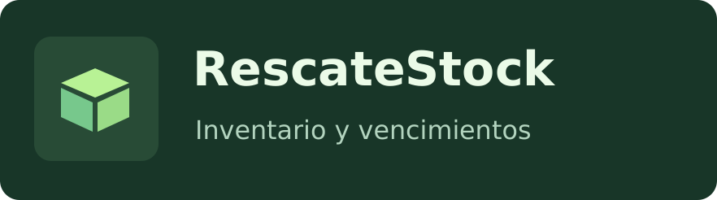

<h1 align="center">Hola, soy David Moscoso 👋</h1><!-- Reemplaza TU-USUARIO y TU_CORREO@gmail.com por tus datos de contacto. -->

  
  

Sobre mí
Soy estudiante de Ingeniería de Software en la Universidad Privada del Norte (UPN), en Lima, Perú. Me interesa el desarrollo backend y estoy aprendiendo a construir APIs REST con Node.js y Express.

Trabajo con JavaScript, HTML y SQL. Actualmente estoy dando mis primeros pasos con TypeScript y practicando cómo conectar una aplicación web con una base de datos. Me gusta entender el problema y ordenar la lógica antes de llevarla a código.

Busco prácticas preprofesionales en desarrollo web o backend para aplicar lo que aprendo, colaborar con un equipo y ganar experiencia en proyectos de software.
Tecnologías

  
  
  

JavaScript · HTML · Node.js · Express · SQL (SQL Server) · TypeScript (en aprendizaje)
Proyecto destacado
RescateStock es una aplicación web en desarrollo para ayudar a pequeños comercios a reducir la pérdida de productos por vencimiento. Permite registrar productos, identificar cuáles están cerca de vencer y proponer promociones para darles salida.

Mi siguiente paso es incorporar una API con Node.js y Express y guardar los datos en una base de datos SQL.
Estadísticas de GitHub

